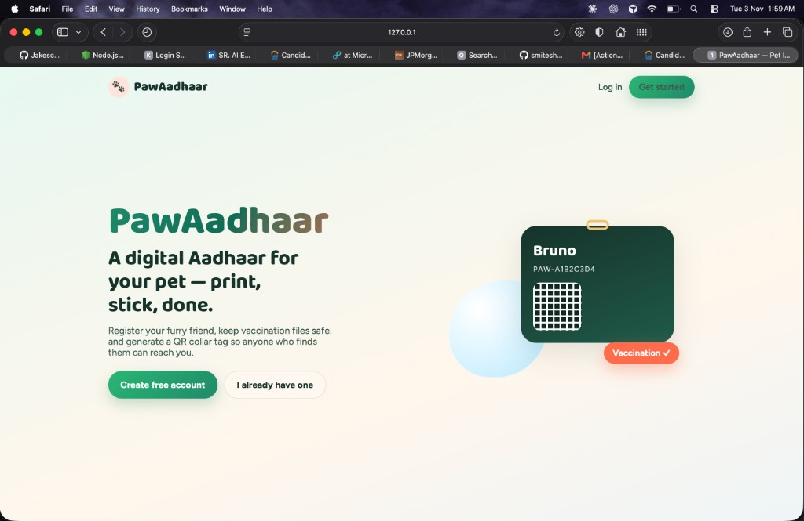
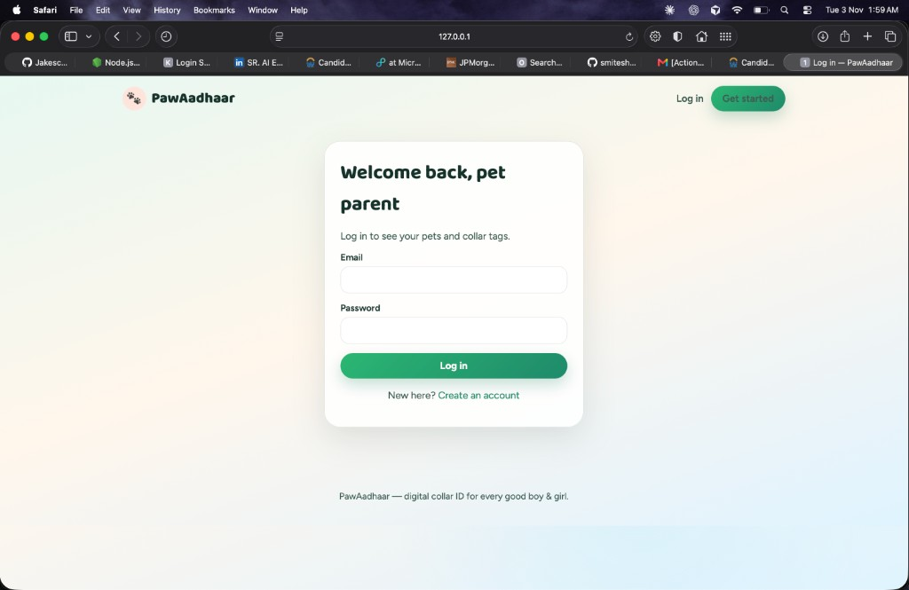
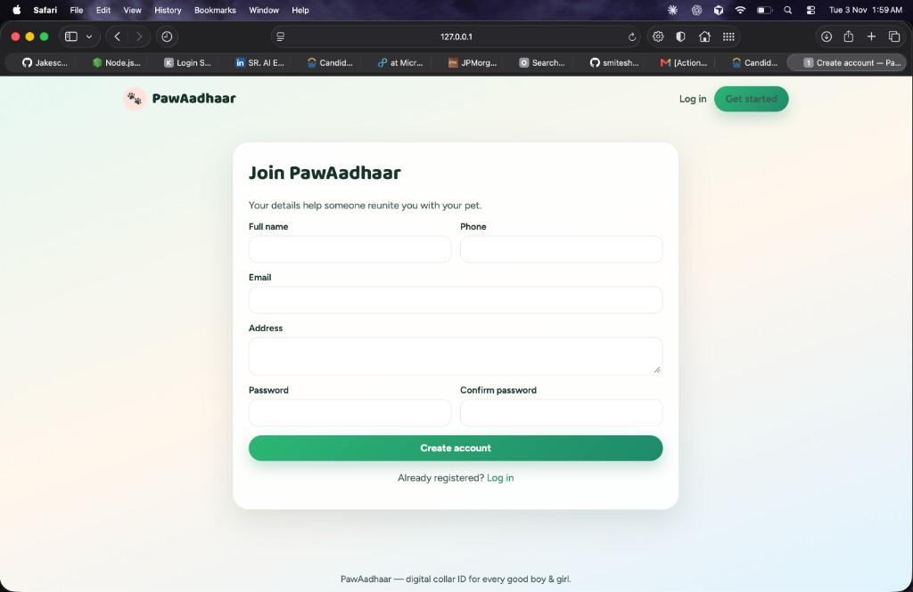
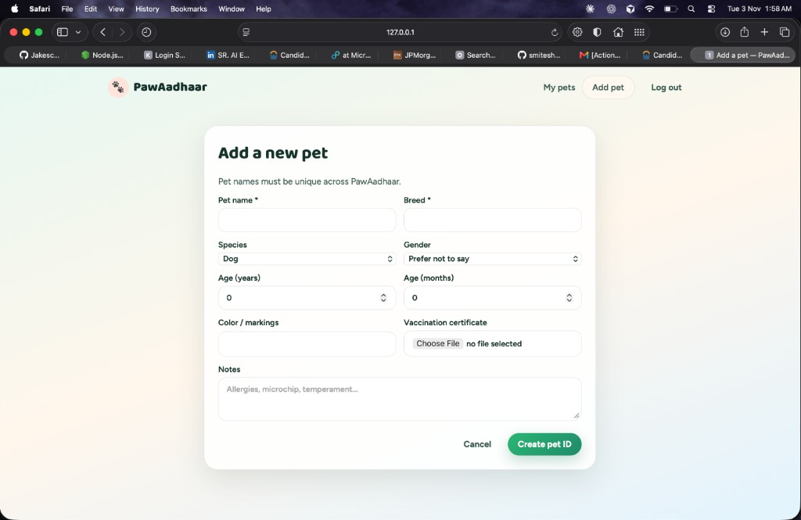
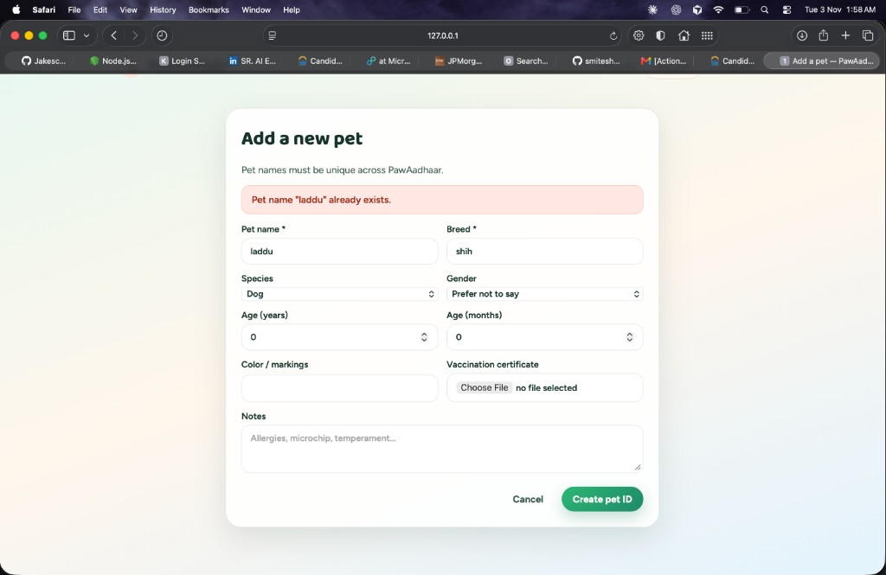
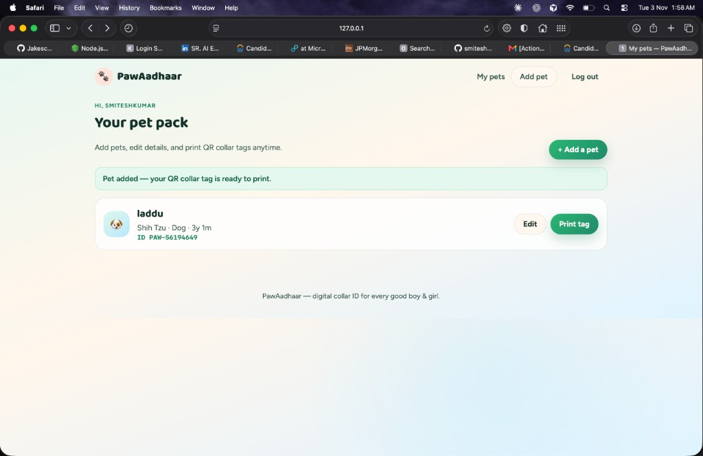
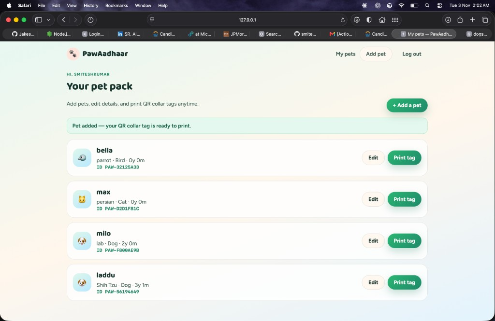
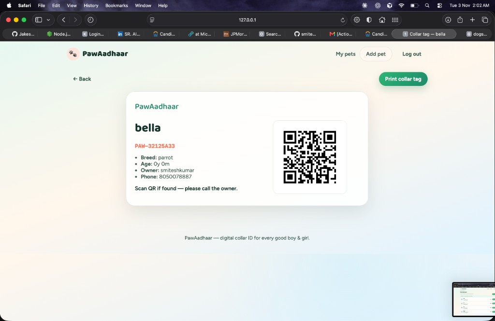

# PawAadhaar

Digital collar ID for pets — register owners and pets, upload vaccination certificates, and print a QR tag for the dog (or cat) collar.

Anyone who finds a lost pet can scan the tag and see how to contact the owner.

---

## Features

- **Owner accounts** — register / login with name, email, phone, address
- **Multiple pets** per account with a clear dashboard list
- **Pet profile** — name, breed, species, age, color, gender, notes, vaccination file
- **Unique pet names** — duplicate names are blocked with a clear error
- **Edit pets** from the list anytime
- **QR collar tag** — printable page with owner contact + scannable QR
- **Public scan page** — `/p/{PAW-ID}` shows pet + owner contact

---

## Tech stack

| Layer | Choice |
|-------|--------|
| Backend | FastAPI + Jinja2 templates |
| Database | SQLite (SQLAlchemy) |
| Auth | Session cookies + bcrypt password hashing |
| QR codes | `qrcode` + Pillow |
| UI | Custom CSS (mint / coral pet theme) |

---

## Quick start

```bash
cd pet-aadhaar
python3 -m venv .venv
source .venv/bin/activate
pip install -r requirements.txt
uvicorn app.main:app --reload
```

Open **http://127.0.0.1:8000**

---

## Project structure

```
pet-aadhaar/
├── app/
│   ├── main.py              # Routes (auth, pets, tags, public profile)
│   ├── api/deps.py          # Session auth helpers
│   ├── core/config.py       # Settings from .env
│   ├── db/                  # Models + SQLite session
│   └── services/            # Auth + pet/QR logic
├── templates/               # Landing, auth, dashboard, forms, tag print
├── static/css/styles.css    # Pet-oriented UI
├── storage/
│   ├── uploads/             # Vaccination certificates
│   ├── qr/                  # Generated QR images
│   └── pet_aadhaar.db       # SQLite database
├── docs/screenshots/        # Product screenshots (see below)
└── requirements.txt
```

---

## Main flows

1. Create an owner account  
2. Add one or more pets (name must be unique)  
3. Optionally upload a vaccination certificate  
4. Open **Print tag** → print / stick on collar  
5. Scanning the QR opens the public pet profile with owner phone

---

## Screenshots (in order)

Screenshots below follow the real product walkthrough from landing → print tag.

### 1. Landing page



**What you see**
- Brand **PawAadhaar** as the hero signal
- Tagline: *A digital Aadhaar for your pet — print, stick, done*
- CTAs: **Create free account** and **I already have one**
- Decorative collar-tag preview (Bruno / sample PAW ID + Vaccination ✓)

**Route:** `/`

---

### 2. Login



**What you see**
- *Welcome back, pet parent*
- Email + password fields
- **Log in** button
- Link to create an account for new users

**Route:** `/login`

---

### 3. Register (owner details)



**What you see**
- *Join PawAadhaar*
- Owner fields: full name, phone, email, address, password, confirm password
- **Create account** stores the owner in the database and signs them in

**Route:** `/register`

---

### 4. Add a new pet



**What you see**
- Form for pet name, breed, species, gender, age (years/months), color, vaccination certificate upload, notes
- Note that pet names must be unique across PawAadhaar
- Actions: **Cancel** / **Create pet ID**

**Route:** `/pets/new`

---

### 5. Duplicate pet name error



**What you see**
- Same add-pet form after submitting a name that already exists
- Red alert: **Pet name "laddu" already exists.**
- Form keeps the entered values so the user can change the name and retry

This enforces the rule that no two pets can share the same name.

---

### 6. Dashboard — first pet added



**What you see**
- Personalized greeting (*Hi, smiteshkumar*)
- Success banner: *Pet added — your QR collar tag is ready to print*
- First pet card for **laddu** (Shih Tzu · Dog · 3y 1m) with ID `PAW-56194649`
- Actions: **Edit** and **Print tag**

**Route:** `/dashboard`

---

### 7. Dashboard — full pet pack



**What you see**
- Multiple pets listed for one owner:
  - **bella** — parrot · Bird · `PAW-32125A33`
  - **max** — persian · Cat · `PAW-D2D1F81C`
  - **milo** — lab · Dog · `PAW-F800AE9B`
  - **laddu** — Shih Tzu · Dog · `PAW-56194649`
- Species icons (bird / cat / dog)
- Each row supports **Edit** and **Print tag**

Shows that one logged-in user can manage many pets from a single list.

---

### 8. Print collar tag (QR)



**What you see**
- Printable tag for **bella**
- PawAadhaar ID `PAW-32125A33`
- Breed, age, owner name, phone
- Generated **QR code** (scan → public profile)
- **Print collar tag** button (browser print)

**Route:** `/pets/{id}/tag`  
**Public scan URL:** `/p/{aadhaar_id}`

---

## Screenshot series summary

| # | Screen | Purpose |
|---|--------|---------|
| 1 | Landing | Introduce product + CTAs |
| 2 | Login | Existing owner sign-in |
| 3 | Register | Capture owner details into DB |
| 4 | Add pet | Create pet profile + optional vaccination file |
| 5 | Duplicate error | Unique name validation |
| 6 | Dashboard (1 pet) | Success state + list entry |
| 7 | Dashboard (many pets) | Multi-pet management |
| 8 | Print tag | QR collar tag ready to stick |

---

## API / page map

| Method | Path | Description |
|--------|------|-------------|
| GET | `/` | Landing |
| GET/POST | `/register` | Owner signup |
| GET/POST | `/login` | Owner login |
| POST | `/logout` | End session |
| GET | `/dashboard` | Pet list |
| GET/POST | `/pets/new` | Add pet |
| GET/POST | `/pets/{id}/edit` | Edit pet |
| GET | `/pets/{id}/tag` | Printable QR tag |
| GET | `/pets/{id}/certificate` | Download vaccination file |
| GET | `/p/{aadhaar_id}` | Public pet profile (QR target) |

---

## Environment

Configured via `.env`:

```env
APP_NAME=PawAadhaar
SECRET_KEY=change-me-paw-aadhaar-dev-secret
DATABASE_URL=sqlite:///./storage/pet_aadhaar.db
UPLOAD_DIR=storage/uploads
QR_DIR=storage/qr
BASE_URL=http://127.0.0.1:8000
```

Set `BASE_URL` to your public URL in production so QR codes point to the right host.

---

## License

Personal / project use.
